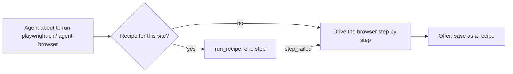

# Replay-Anything

[](https://github.com/ness001/replay-anything/actions/workflows/ci.yml)
[](LICENSE)


Turn a website operation you repeat (for example "post a chat message with an image") into a
named, verified **recipe** that agents (Claude Code, Codex, GitHub Copilot) run in one step,
instead of driving a browser turn by turn.

- **High availability:** a recipe is verified once and then runs the same way every time.
- **Performance:** one step instead of many browser turns, so repeat tasks finish in seconds.
- **Cost efficiency:** far fewer tokens per run, and none at all when run from the CLI.

See the [benchmark](#benchmark) for measured results.

> **v1: websites only; desktop apps possibly later.**

## Quick start

```bash
claude plugin install replay-anything --marketplace https://github.com/ness001/replay-anything
```

Restart Claude Code, then ask: *"Make a recipe to post a message to my team chat."* The agent signs you in
once, watches you do it, and saves a recipe. Next time, *"post 'build is green' to my team chat"* runs in
one step. Codex and GitHub Copilot are covered in [Install](#1-install).

## Parts

| Part | What it does |
|---|---|
| Skill (`skills/replay-anything/SKILL.md`) | Builds a recipe: you log in once in a real browser, do the operation once while traffic is recorded, then the agent writes the recipe and tests it with new inputs. |
| MCP server | Runs recipes. Exactly two tools: `list_recipes(site?, query?)` and `run_recipe(recipe, inputs)`. |
| CLI `replay-anything` | Same runtime, for scripts and scheduled tasks: `list`, `run`, `validate`, `login`, `link`, `export-state`, `auto`, `hook`, `record`, `analyze`, `where`. |

A recipe is a small YAML file. It has `request` (HTTP), `websocket` and `browser` steps, passes
values between steps with `extract` and `{{step.field}}`, uses `when` for optional steps and
`expect` for checks, and can include a browser `fallback`. The runtime tries request replay
first and uses the fallback only if replay fails. See `examples/local-chat/` and the format
reference in the skill.

**No secrets in recipes.** Sessions are saved in a per-user folder (`replay-anything where`), never in a recipe.

## User guide

### 1. Install

Pick one per agent. Each one installs the skill, the MCP server, the browser hooks and auto-save.
The only requirement is Python 3.11+ on `PATH`. On first start the plugin sets up its own `.venv`, which takes
about a minute. Then restart the agent.

**Claude Code**
```bash
claude plugin install replay-anything --marketplace <path or git URL of this repo>
```

**Codex**
```bash
codex plugin marketplace add <path or git URL of this repo>
codex plugin add replay-anything@replay-anything
```
Then open `/hooks` once and trust the Replay-Anything hooks. Codex skips plugin hooks until you trust them.

**GitHub Copilot CLI**
```bash
copilot plugin marketplace add <path or git URL of this repo>
copilot plugin install replay-anything@replay-anything
```

**Updating:** raise `version` in `pyproject.toml`, `replay_anything/__init__.py`,
`.claude-plugin/plugin.json` and `.codex-plugin/plugin.json` (a test checks they agree), then:

| Agent | Steps |
|---|---|
| Claude Code | `claude plugin update replay-anything@replay-anything`, then restart Claude Code so the MCP server restarts. Without a new version number, `update` changes nothing. |
| Codex | Run `codex plugin remove` and then `add`. Codex keeps a copy of the plugin. |
| Copilot | Nothing to do. It loads a local folder live. |

Older Codex/Copilot versions without plugin support can use `python install.py --rules`. It installs the
MCP server, the skill and a short rule, but no hooks.

### 2. Make a recipe (once per operation)

Tell your agent: *"Make a recipe to post a message to Teams Note to self."* The `replay-anything` skill
then walks you through it:

1. **Sign in.** `replay-anything login https://site` opens a browser. You sign in (SSO/2FA) and close it.
   Already signed in with playwright-cli or agent-browser? Link that login instead (see section 4).
2. **Do it once.** `replay-anything record https://site --out <folder>`. You do the operation once.
3. **The agent writes and tests the recipe** with new inputs, and checks the result on the site.

Recipes are saved in the per-user `recipes` folder (on Windows `%LOCALAPPDATA%/replay-anything/recipes`;
`replay-anything where` shows the folders).

You can also start from browser work you already did: after the agent finishes a task with
playwright-cli or agent-browser, say *"save this as a recipe"*.

### 3. Use a recipe

Ask in plain words: *"post 'build is green' to my Teams note to self"*. The agent finds the recipe with
`list_recipes` and runs it with `run_recipe` in one step. Or run it from a script or scheduled task:

```bash
replay-anything list
replay-anything run teams.microsoft.com/post_note_to_self -i text="build is green"
```

### 4. Using it with playwright-cli and agent-browser

**When you ask for a browser tool by name** (*"use playwright-cli to post X"*), the agent does what you
asked. Link the tool's login so you only sign in once:

```bash
playwright-cli state-save ~/.auth/teams.json            # or: agent-browser state save ~/.auth/teams.json
replay-anything link https://teams.microsoft.com --state ~/.auth/teams.json
```

**When the agent picks a browser tool by itself**, it is told about matching recipes first:

- **Claude Code:** the plugin's hook checks every Bash command (a quick text check; only
  `playwright-cli`, `agent-browser` and `npx @playwright/cli` commands go further). If the command opens a
  site that has recipes, the agent sees a note like:

  ```text
  Replay-Anything has saved recipes for this site. If one matches the task, the MCP tool run_recipe does it
  in one step (...); the browser is still available if no recipe fits or run_recipe returns step_failed.
  - teams.microsoft.com/post_note_to_self: Post a text message to your own Microsoft Teams "Note to self" chat ... (inputs: text: string)
  ```
  It only adds a note and never blocks the command. Commands for other sites are not affected. A recipe for
  `x.com` also matches `www.x.com`. If the site has a port, the port must match too. The hook stays silent
  until the MCP server has set up `.venv` once.
- **Codex:** same hook. Codex shows the note just before the command runs.
- **Copilot:** Copilot hooks can't add a note before a command runs, so the note comes with the
  command's result.



### 5. Auto-save (on by default)

When an agent does a task on a site with playwright-cli or agent-browser and no recipe covers that site,
it saves the work as a recipe at the end of the task and tells you the recipe id in one line. You don't
need to ask.

- **Claude Code:** the plugin's hooks keep track of which sites were used. When the agent finishes, they
  ask it once per site per session.
- **Codex / Copilot:** the same hooks do this. With `install.py --rules` (no hooks), the rule text asks the
  agent to do it instead.
- **Skipped:** exploration, failed work, and tasks that aren't repeatable.
- **Recipes that change something** (post, send, edit, delete) are saved with `tested: false` and are not
  run, so nothing is posted twice. Their first real run is the test, and a successful run clears the mark.
  Read-only recipes are tested right away.

Turn it off or on:

```bash
replay-anything auto off       # stays off until "auto on"
replay-anything auto status
REPLAY_ANYTHING_AUTO_RECIPE=0  # environment variable: off for one session only
```

### 6. When something goes wrong

| You see | Do this |
|---|---|
| `session_expired` | Run the `login` command it names. If you linked a file, refresh it with the tool (`state-save`) or run `replay-anything link <site> --remove`. |
| `step_failed` | The site probably changed. The message names the failing action (for example `action 11 (click ...)`), and `fix` gives the recipe file and the folder with a screenshot and the page text. Say *"fix the recipe"*: the agent follows the skill's "Fix a recipe" section, redoes only the broken step in the browser and patches it. |
| `bad_inputs` | It lists the expected inputs. |
| The hook says nothing | Check that the recipe's `site` host matches the URL in the command, and that the plugin is installed (`/hooks` in Claude Code). |

### 7. Configuration

Most people need none of this. Settings for one recipe go in the recipe file; the rest are commands or
environment variables.

| To | Use |
|---|---|
| Turn auto-save off or on | `replay-anything auto off` / `on` / `status` (`REPLAY_ANYTHING_AUTO_RECIPE=0` for one session) |
| Reuse a login from playwright-cli or agent-browser | `replay-anything link <site> --state <file>` or `--profile <dir>` (section 4) |
| Hand a login to playwright-cli or agent-browser | `replay-anything export-state <site> <file>` |
| Pass inputs from a script | `replay-anything run <recipe> -i name=value` (repeatable) or `--json '{...}'` |
| Check a recipe without changing anything | `--dry-run` (CLI) or `dry_run=true` (`run_recipe`) |
| Use only, or never, the browser fallback | `run --browser` / `run --no-fallback` |
| Share recipes with a team | `REPLAY_ANYTHING_RECIPES=<folder>` (several separated by `;` on Windows, `:` elsewhere) |
| Watch the browser while it runs | `REPLAY_ANYTHING_HEADED=1`, or `headed: true` in one recipe |
| Work with a bot-protected site | `transport: browser` and `pacing: human` in that recipe ([Sites with bot protection](#sites-with-bot-protection)) |
| Repeat browser actions for each item in a list | `for_each: "{{inputs.ids}}"` on a browser step |
| Move the data folder | `REPLAY_ANYTHING_HOME=<folder>` (`replay-anything where` shows the current one) |
| See response text in errors | `REPLAY_ANYTHING_DEBUG=1` (off by default: error pages can echo tokens) |

## Install details

- `launch.py` creates `.venv` on first start. If you need a package mirror, set `PIP_INDEX_URL`.
- Browser steps use installed Edge or Chrome. If neither is installed, run `playwright install chromium`.
- `install.py` backs up each config file it changes to `<file>.replay-anything.bak` the first time, and keeps
  your other entries.

## Works with playwright-cli and agent-browser

All three tools save logins in the same Playwright storage-state format, so you can reuse a login you
already have:

```bash
playwright-cli state-save ~/.auth/site.json        # or: agent-browser state save ~/.auth/site.json
replay-anything link https://site.example.com --state ~/.auth/site.json
replay-anything link https://site.example.com --profile <dir>    # a persistent --profile folder
replay-anything export-state https://site.example.com out.json   # playwright-cli state-load out.json
                                                                  # agent-browser --state out.json open <url>
```

Tested on Teams (2026-11-05): a linked **profile** from playwright-cli or agent-browser works. Edge can't
open such a copy, so the profile opens in Chrome instead. There Teams briefly shows "Almost there…" over the
chat, so the Teams recipe waits for it to clear (`wait_for: {selector: ..., gone: true}`); a post then took 55-78 s,
against 17-32 s with the profile `replay-anything login` makes. A linked **state file** did not work: Teams
did not accept it and redirected to the Microsoft login page.

`link` stores only the path, and the file is read on every run. When the other tool refreshes the file, recipes
use the new login. Only cookies and origins for the recipe's site are used from a linked state file. A linked **profile** is passed to the
browser whole, so link a profile folder you only use for that site. The skill also
tells agents to call `run_recipe` first, and to use playwright-cli or agent-browser only when no recipe fits
or a recipe fails. It also explains how to turn their element refs into stable selectors.

## Benchmark

Task: post one text message to your own Teams "Note to self" chat, again and again. Each run is a fresh
Claude subagent (Opus 5, Claude Code). Measured 2026-11-05 on one Windows machine with playwright-cli 0.1.22,
agent-browser 0.27.0 and replay-anything 0.2.0. 3 runs per row.

The question is what to use for the repeat runs **if you already use a browser tool**. So each tool is
compared only with itself. A 1st run is always needed to learn the task, so it is shown for reference
only; the real choice is how to do the runs after it. Each table compares the recipe (built from that
tool's session) with the three other ways of repeating with that tool. "Recipe vs this" is how much less
time or tokens the recipe used than that row, so -37% means the recipe took 37% less. The two
tables are not a comparison of playwright-cli with agent-browser.

Why use a recipe for the repeat runs:

- **High availability:** recipes posted 6 out of 6 times (3 built from each tool). Every other way of
  repeating failed at least once, except agent-browser's same-session repeat (3/3); agent-browser's
  record and replay failed 3 out of 3.
- **Performance:** 22 s per post, **37-78% faster** than every other way of repeating with either tool.
- **Cost:** 176k tokens per post, **20-52% fewer** than every other way of repeating with either tool. With no agent (the CLI row), a run costs 0 tokens.

Rows (run for each tool):

- **1st run:** the agent explores Teams and posts. Shown for reference; every approach needs it once.
- **Same session, same request:** the same agent is asked to post again, with no instructions on how. Only the second post is measured.
- **Record and replay:** the agent saves its steps while posting (playwright-cli `recording-start`/`stop`,
  agent-browser a `batch` list), then posts again by replaying that file. Only the replay is measured.
- **Agent-written skill:** one agent posts and writes a skill; fresh agents then post using only that skill.
- **run_recipe:** one agent posts with the tool and turns that session into a recipe
  (replay-anything skill); fresh agents then call `run_recipe`.
- **CLI (no agent):** `replay-anything run <recipe> -i text=...` timed in a terminal. No model is involved.

Medians are over successful runs; the range is min-max.

**playwright-cli**

| Run | Success | Time, median (range) | Recipe vs this | Tokens, median (range) | Recipe vs this |
|---|---|---|---|---|---|
| playwright-cli 1st run | 3/3 | 74 s (71-90) | - | 423k (340-426) | - |
| playwright-cli same session, same request | 2/3 | 35 s (30-40) | -37% | 220k (187-252) | -20% |
| playwright-cli record and replay | 2/3 | 41 s (38-44) | -46% | 260k (259-262) | -32% |
| playwright-cli agent-written skill | 3/3 | 68 s (68-69) | -68% | 363k | -52% |
| **replay-anything run_recipe** | **3/3** | **22 s (21-22)** | **-** | **176k** | **-** |
| replay-anything CLI (no agent) | 3/3 | 19 s (18-21) | - | 0k | - |

**agent-browser**

| Run | Success | Time, median (range) | Recipe vs this | Tokens, median (range) | Recipe vs this |
|---|---|---|---|---|---|
| agent-browser 1st run | 3/3 | 91 s (89-107) | - | 379k (365-427) | - |
| agent-browser same session, same request | 3/3 | 70 s (69-73) | -69% | 318k (316-333) | -45% |
| agent-browser record and replay | 0/3 | - | - | - | - |
| agent-browser agent-written skill | 3/3 | 99 s (92-100) | -78% | 365k | -52% |
| **replay-anything run_recipe** | **3/3** | **22 s (21-23)** | **-** | **176k** | **-** |
| replay-anything CLI (no agent) | 3/3 | 19 s (18-21) | - | 0k | - |

The CLI row is the same measurement in both tables (the recipe runner doesn't depend on which tool the
recipe was built from).

How to read it:

- **Reliability:** the failures came from steps an agent saved without trying them. A playwright-cli replay
  script waited 30 s for a chat-header element that never appeared. agent-browser's three `batch` lists each
  stopped on a selector that matched nothing (twice at the sidebar item, once at the chat check). A recipe is
  checked with a dry run before it is saved and is marked tested on its first real run. One playwright-cli
  same-session repeat also lost its browser when it shared playwright-cli's "default" session with another program;
  later runs used named sessions.
- **Speed:** a recipe is one tool call, so it doesn't depend on how the agent explores. A skill written by an
  agent saved little or nothing: the next agent still snapshots and clicks step by step.
- **Why run_recipe still costs 176k tokens:** running the recipe itself uses no tokens (see the CLI row).
  The tokens come from the agent around it: 3 calls (`list_recipes`, `run_recipe`, reply), each re-sending
  the system prompt and tool list; 73% of the tokens are that prompt read from cache. Any agent run in this
  setup needs at least 2 calls, so this is close to the minimum. The skill runs took 6 calls.
- **Safety:** every saved route (script, `batch` list, skill, recipe) checks that the open chat is exactly
  "Note to self" before typing. No run posted to the wrong chat.

Notes:

- **Tokens** are input + cache read + cache write + output, added up over every API response in the
  subagent's transcript.
- **Not included:** the one-time setup posts (the recording, the skill writer, the recipe builder).
- **Chat route:** every run reached the chat by clicking it in the sidebar, never by its URL.
- **Method and raw data:** [`bench/METHOD.md`](bench/METHOD.md) describes how each row was run;
  [`bench/results.csv`](bench/results.csv) has every run's numbers, and `python bench/summarize.py` prints
  the same numbers (it labels each tool's recipe row with the tool name, where the tables above say
  "replay-anything run_recipe").

## Checking a recipe without changing anything

`run_recipe(..., dry_run=true)` (CLI: `replay-anything run <recipe> --dry-run -i ...`) runs everything up to
the first action that would change the site, then stops and reports it as `stopped_before`. Those
actions are a browser `click` with `wait_response` or `submits: true`, a `press` of Enter, any websocket
step, and any request step other than GET/HEAD/OPTIONS. Mark an action `submits: false` if it is safe (Enter in
a search box). A dry run refuses to start when a recipe marks no such action, because it could not stop in
time. It trusts the recipe: a site that changes data on a GET is not caught.

Failure screenshots and page text are kept in a private `failures/` folder (newest 20 only). They can show
private data, so don't share them without looking first.

## Sites with bot protection

By default request steps are sent from Python (httpx), and browser steps run headless. Sites behind
bot defenses (Akamai, PerimeterX, Cloudflare, DataDome) often reject that. Three opt-in recipe fields help:

```yaml
transport: browser   # send request steps with fetch() from a page on the site, in the login profile
headed: true         # open a visible browser window instead of headless
pacing: human        # wait a random 0.5-2 s between steps and between browser actions
```

With `transport: browser`, the site is loaded once first, so its own scripts run and set whatever they set;
each request then carries the real browser's cookies, TLS and headers. All browser steps in a run share one
page. Websocket steps still go through Python. Differences from the default: a redirected request is
stopped instead of followed (a redirect with a saved session is reported as `session_expired`), `extract`
can only read response headers the site exposes to scripts (never `Set-Cookie`), and `via` is `browser`.

Since the browser-transport change, all browser steps in a run share one page: a browser step starts where the
previous one ended. Start a step with `goto` if it needs a fresh page.

Replay-Anything has **no stealth features** and won't add them: it doesn't hide `navigator.webdriver`,
change the user agent, or fake plugins or fingerprints, the same as Playwright itself. These options make a
run behave like a real browser used at a person's pace; they don't hide that it is automated. Sites such as
LinkedIn, Meta and Ticketmaster forbid automation in their terms and may suspend accounts. Use recipes
only for your own tasks on sites that allow it.

## Errors returned by `run_recipe`

`bad_inputs` (includes `expected_inputs`), `session_expired` (gives the `login` command to run),
`step_failed` (names the step and, for browser steps, the action number, with a screenshot and the page
text saved under `failures/` in the per-user folder; also reports the fallback error if the fallback ran; its `fix`
field gives the recipe file and failure folder for repairing it), and
`recipe_not_found` (lists candidates).

## Known limits

- Sites that sign API calls with tokens kept in JavaScript or browser storage (Teams, many
  SPAs) can't be replayed with cookies alone. Use `browser` steps for them (`transport: browser` only
  adds what the browser itself sends, such as cookies, not tokens a page script attaches to its own calls). Corporate SSO that
  depends on device identity works through the persistent profile that `login` creates.
- `record` keeps the raw HAR (it contains cookies) in the per-user `recordings` folder, and
  writes only a redacted summary to `--out`, which must be outside any git repo. Delete the raw HAR
  once the recipe is done.
- `file` inputs can be any local file the user can read. An agent could be tricked into
  uploading a sensitive file to a recipe's site. Recipes only reach their own site, but review
  `run_recipe` calls that pass file paths.

## Contributing

Bug reports and pull requests are welcome. See [CONTRIBUTING.md](CONTRIBUTING.md) for setup and tests,
and [SECURITY.md](SECURITY.md) to report a security issue privately.

## License

GPL-3.0. See [LICENSE](LICENSE).
